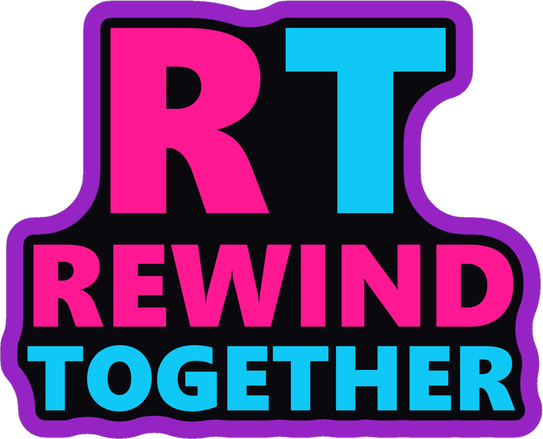
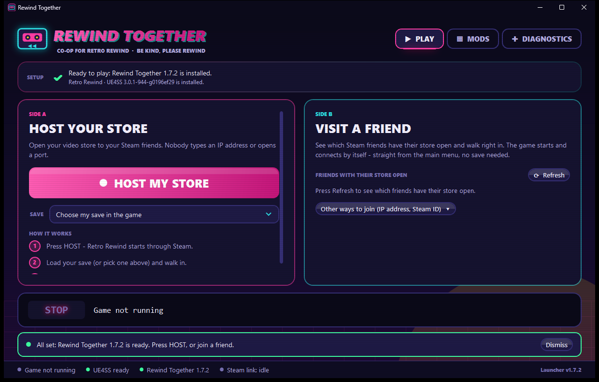
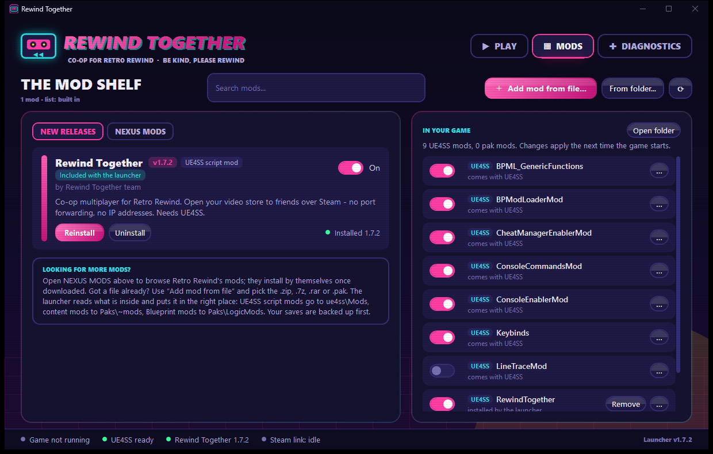

  

<h3 align="center">Co-op multiplayer for Retro Rewind - Video Store Simulator</h3>

  Open your video store to friends and run it together. 
  Same shelves, same stock, same till, same clock.

  
  
  
  

  <a href="https://github.com/Geckomacabre/RewindTogether/releases/latest"><b>⬇&nbsp;Download</b></a>
  &nbsp;·&nbsp;
  <a href="HOW%20TO%20PLAY%20-%20START%20HERE.txt"><b>How to play</b></a>
  &nbsp;·&nbsp;
  <a href="#-if-something-goes-wrong"><b>Help</b></a>
  &nbsp;·&nbsp;
  <a href="https://github.com/Geckomacabre/RewindTogether/issues"><b>Report a bug</b></a>

  

---

## 📼 Play in three steps

1. **[Download the latest release](https://github.com/Geckomacabre/RewindTogether/releases/latest)**,
   right-click the zip and choose **Extract All...**
2. **Open `RewindTogetherLauncher.exe`** from the unzipped folder. That's the whole install.
   It finds Retro Rewind, backs up your saves, and sets up the UE4SS loader and the mod by itself.
3. **Play.**
   - **Hosting:** press **HOST MY STORE**, load your save, and walk into your store. It opens to
     your Steam friends by itself.
   - **Joining:** under **Visit a friend**, pick a friend whose store is open and press **JOIN**.
     The game starts and connects straight from the main menu. You don't need a save of your own.

New to all this? **[HOW TO PLAY - START HERE.txt](HOW%20TO%20PLAY%20-%20START%20HERE.txt)** (also
in the download) walks hosts and guests through every step.

> [!NOTE]
> Everyone needs the **same version of the mod** and the **same version of the game**. If Steam
> updates Retro Rewind, wait for a mod update before playing together.

> [!TIP]
> **Updating is one click.** When a new version is out, the launcher shows a green banner. Press
> **Update**: it downloads the release from here, checks it, swaps itself and the mod, and
> restarts, with your saves and settings untouched. Update together, between sessions.

> [!IMPORTANT]
> If Windows says **"Windows protected your PC"**, click **More info**, then **Run anyway**. The
> launcher isn't code-signed yet.

---

## 🏪 What you get

| Feature | What it means |
|---|---|
| 🏬 **One shared store** | The host's save is the store everyone plays in: shelves, stock, decorations, expansions and the sign, exactly as the host sees them. |
| 🛒 **Guests work the store** | Pick up and shelve tapes, ring customers up at the till, use build mode and the paint tool, talk to the staff. Every action happens on the host's game, so all screens match. |
| 🌆 **The whole town matches** | Money, XP and level, the clock, the day, season and weather, the sky and street lights, every customer's looks and words, and the end-of-day summary. |
| 💾 **Only the host saves** | A guest's own saves are never read or written. |
| 🧩 **Mods from Nexus Mods** | Browse Retro Rewind's mods inside the launcher. **Download** takes one click on Nexus, and the launcher installs the file by itself. |
| 🤝 **Mod check before joining** | The launcher tells you when your mods differ from the host's, and **Get their mods** lists the ones you're missing. |
| 💬 **Discord status** | Your profile says **Playing Rewind Together**, with what you're doing and how many are in the store. No names or IDs are shown. |

<b>Everything a guest can do, checked in game on both screens</b>

- Right-click picks up and uses things, left-click places them; **E**, **V**, **B** switch tools
  and **K** sells, just like in single player.
- Take a tape off a shelf and put it back, with the item and its details on the guest's own HUD.
- **Ring customers up at the till:** the register's screen, the bill, the customer's cash and the
  change on the counter.
- **Build mode:** pack furniture and place it, with the guest's own green/red placement preview.
- **The paint (skin) tool:** colours for the carpet and the shelves.
- **Talk to the staff member:** the conversation opens on the guest's screen and the guest
  answers it. Other conversations, such as a customer's, take the same path but were not each
  tried.

<b>Everything that stays in sync</b>

- **Money, XP, level and the clock**, on the guest's own HUD.
- **Day, weekday, season and weather**, including the season scenery (snow, bare trees).
- **The sky, sun, fog and street lighting.**
- **The town's customers and passers-by:** their looks (body, clothes, colours, hair), their
  animation, what they say, and the basket or cash in their hands.
- **Shelf titles, the signs you wrote and the film posters.**
- **The end of the day:** the host's summary, the XP bar and the level-up unlocks, then the
  new-day banner.

---

## 🧩 More mods

  

- **NEXUS MODS** in the launcher's Mods tab lists Retro Rewind's mods on Nexus Mods, with
  search, sorting and pictures. Adult mods stay hidden unless you switch them on.
- **Download** opens the mod's download page on Nexus, where it's one click (a free Nexus account
  is enough). The launcher picks the file up from your Downloads folder and installs it, backing
  up your saves first. `.zip`, `.7z`, `.rar` and `.pak` all work, and so does **Add mod from
  file** for anything you already have.
- Installed mods show **INSTALLED** or **UPDATE AVAILABLE**.
- **Playing together:** the host and every guest should have the same content mods (`.pak` and
  Blueprint mods). Before you join, the launcher compares yours with the host's and says what
  differs: the Rewind Together version (must match), content mods (should match, or things go
  missing) and UE4SS script mods (usually fine). When the host got theirs through the launcher,
  **Get their mods** lists exactly those. You can always choose **Join anyway**.

---

## 🌐 Ways to connect

| Route | Setup | Status |
|---|---|---|
| **Steam** (friends list or *Join Game*) | nothing: the launcher carries the game over Steam's relay | needs real-world testing, please report how it goes |
| **Same house / LAN** | *Join by address* with the host's local IP | works |
| **VPN** (Tailscale, ZeroTier, Radmin) | both join the same VPN, then *Join by address* | works (how the mod was first tested) |
| **Port forward** (UDP 27015) | `Extras\OPEN PORT FOR FRIENDS - Double click me.bat` on the host | works if your router allows it |

Hosting always uses UDP port **27015**. The mod sets it when it opens your store, and it can't be
changed.

---

## 🎮 In game

| Key | Does |
|---|---|
| **F7** | Host: open your store to friends (the launcher does this for you) |
| **F5** | Join `Config.JoinTarget` or a hosting friend |
| **F6** | Status: a short box in the middle of the screen for 8 seconds (in a store), and the full report in `RewindTogether.log` |
| **Esc** | The pause menu, guests included. **Back to the store** in it gets you out of anywhere you're stuck: a guest lands beside the host, the host by the register |

<b>Console commands</b>

Press **~** twice (or **F10** twice) to open the game's console, type the command and press
**Enter**. Press **~** once more to close it. (UE4SS's own console window takes them too, if you
have turned it on. A fresh install doesn't show one.)

| Command | What it's for |
|---|---|
| `rt.status` | Version, who's connected, and whether the sync channel is carrying data |
| `rt.diag` | Everything worth sending with a bug report |
| `rt.join <ip>` | Join by address |
| `rt.native` | The native helper that lets guests act in the store |
| `rt.safety` | What switched itself off after a crash, and how to turn it back on |
| `rt.unstuck` | Back to the store, the same as the pause menu's button |

---

## ⚠️ Known limitations

- **A guest's own game also runs each click locally.** You may see an object jump for a moment
  before the host's version arrives. The host's version always wins.
- **The host decides when the day ends.** Guests see the summary and follow into the next day;
  its buttons are the host's.
- **Guests can't change a shelf's model** (the mesh tool). Colours (the paint tool) work.
- **The office computer's ordering screens are empty on a guest's screen** (placeholder text and
  prices). Ordering movies is the host's job for now.
- **The mouse wheel doesn't switch tools for guests yet.** Use E, V and B.
- **NPC clothes and colours match the host's,** but a customer can look slightly different for a
  moment when it first appears.
- **Tested with two copies of the game on one PC.** Two players on two PCs over the internet,
  and the Steam route in particular, still need real-world testing.

---

## 🛠 If something goes wrong

1. In the launcher, open **Diagnostics** and press **Copy diagnostics**. Paste that into
   [a bug report](https://github.com/Geckomacabre/RewindTogether/issues). If you can, do it on
   both PCs (host and guest).
2. The logs are here:
   - `Retro Rewind\RetroRewind\Binaries\Win64\RewindTogether.log`
   - `...\Binaries\Win64\ue4ss\UE4SS.log`
3. **If the game crashes, just start it again.** The mod notes what it was doing before each risky
   step. The next launch switches that one feature off and says which (`rt.safety`), so you can't
   get stuck in a crash loop.

**Stuck outside the store, or in a wall?** Press **Esc** and choose **Back to the store**.

To remove the mod, use **Uninstall** in the launcher's Mods tab (close the game first).

---

## 🛡 Compatibility and safety

- **Made for** Retro Rewind's Steam build 23896268 ("Changelist 2308"), on Windows 10 and 11.
- **The game's own files stay as they are.** The mod runs entirely through UE4SS: Lua scripts
  plus one small native helper, `RewindNative.dll`, whose source is in the download under
  `Source\RewindNative`. No game `.pak` file is touched.
- **Online:** Retro Rewind has no online mode and no anti-cheat. Co-op runs on Unreal's own
  networking between you and your friends. Nothing goes through a third-party server except
  Steam's relay, if you use it.
- **Saves:** the launcher backs them up before every install, into
  `Documents\RewindTogether Backups`. Keep your own copy anyway.

---

## 👩‍💻 For developers

- [**PROJECT.md**](PROJECT.md): how the mod works, what was measured, and how to test with two
  copies of the game on one PC.
- [**launcher/README.md**](launcher/README.md): the launcher (WPF, .NET 8): building, tests, the
  Steam helper, the self-update, the Nexus browser and the Discord status.
- [**docs/LAUNCHER_CONTRACT.md**](docs/LAUNCHER_CONTRACT.md): the files the launcher and the mod
  use to talk to each other.
- [**MODLOG.md**](MODLOG.md) and [**VERSION.txt**](VERSION.txt): the journal and the changelog.

---

## Credits

- **Rewind Together:** built by the Rewind Together team with heavy help from **Claude
  (Anthropic)** through Claude Code. Most of the code, the reverse engineering and the testing
  were done by an AI agent working on the team's own copy of the game. Every claim in this README
  was checked in the running game unless marked otherwise.
- **UE4SS** by the UE4SS team ([RE-UE4SS](https://github.com/UE4SS-RE/RE-UE4SS)), MIT license.
- **Retro Rewind** by its developers. This mod is not affiliated with or endorsed by them. Please
  buy the game; the mod needs your own copy to work.
- Mods in the launcher's Nexus browser belong to their authors and come from
  [Nexus Mods](https://www.nexusmods.com/retrorewindvideostoresimulator).

## License

Rewind Together is free to use, change and share for **noncommercial** purposes under the
[PolyForm Noncommercial License 1.0.0](LICENSE) (`LICENSE.txt` in the download). Nobody may sell
it. The developer and publisher of Retro Rewind may additionally use it for any purpose,
including building it into the game. UE4SS, which the launcher installs, is under its own MIT
license.
