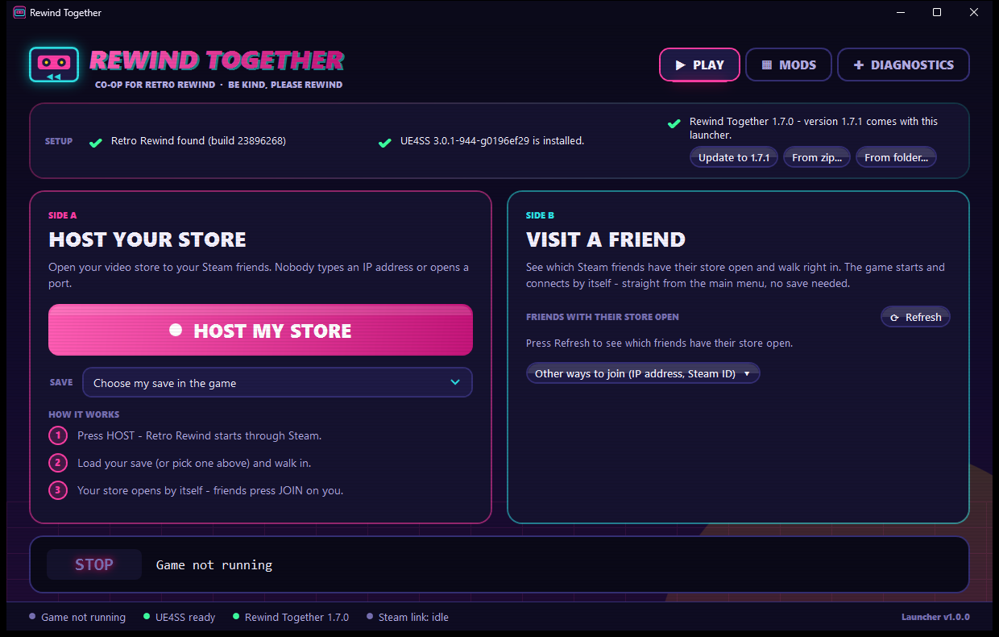
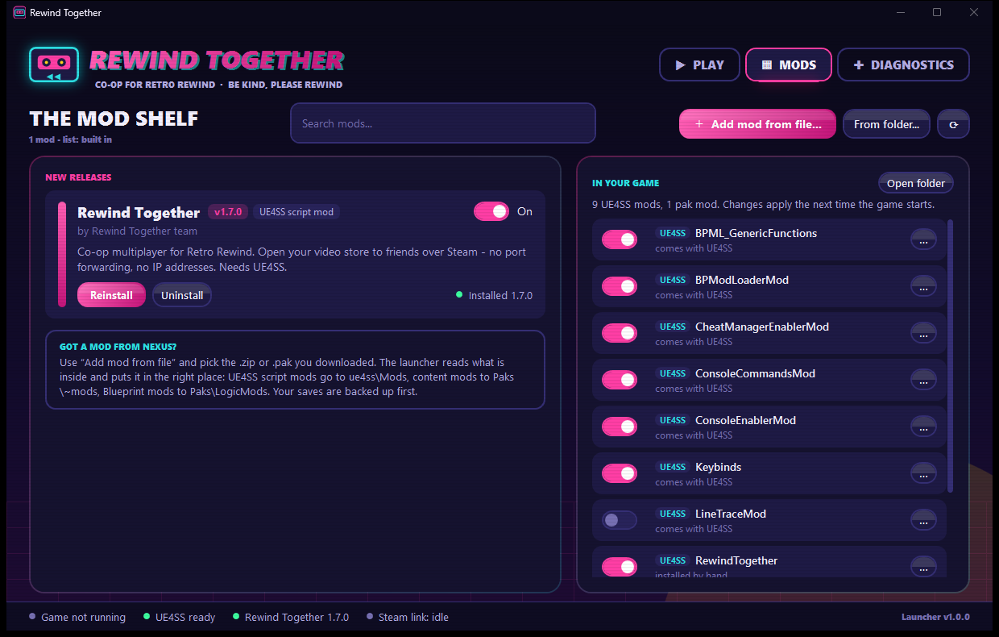
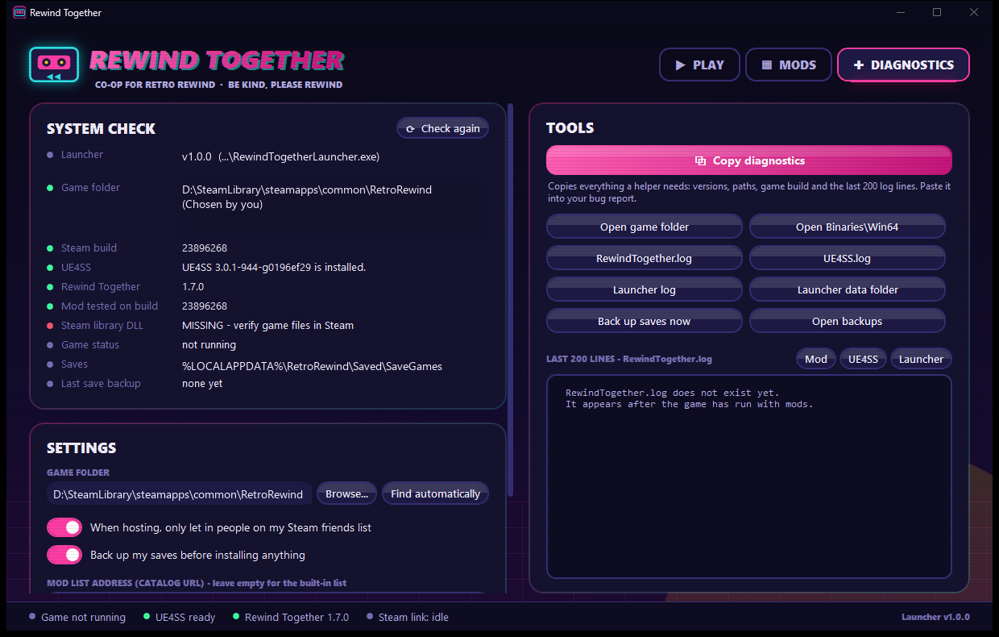

# Rewind Together Launcher

The one-click front door for **Rewind Together**, the co-op mod for Retro Rewind (Steam AppID
3552140). It finds the game, installs UE4SS and the mod, manages other mods, and gets friends
into a session without anyone typing an IP address.

One Windows exe (`dist\RewindTogetherLauncher.exe`, self-contained .NET 8 WPF, about 63 MB). The
player does not need to install .NET. Valve's `steam_api64.dll` is **not** bundled: the launcher
loads the game's own copy at runtime.

The release zip puts the mod and the pinned UE4SS build next to the launcher, and the launcher
installs both from there (no download):

```
RewindTogetherLauncher.exe
Mods\RewindTogether\mod.json
Mods\RewindTogether\Scripts\*.lua
Mods\RewindTogether\native\RewindNative.dll
Mods\UE4SS\UE4SS_v3.0.1-944-g0196ef29.zip      (unmodified, with its LICENSE.txt)
Extras\                                        (port tools for playing without Steam)
```

For a player, setting up is: unzip, open the exe. See "One-click setup" below.

| Play | Mods | Diagnostics |
|---|---|---|
|  |  |  |

Other screenshots:

* `screenshots/save-picker.png`: the "which save to host" picker.
* `screenshots/bundled-update-done.png`: right after the setup row updated the mod from the
  bundled copy.
* `screenshots/first-run-setup.png`: a fresh PC with nothing installed.
* `screenshots/error-dialog.png`: how a failure is reported.

All of them were taken against a fake game folder. The save picker read the real save folder's
file dates.

---

## Build, test, publish

Requires the .NET 8 SDK or newer (built with SDK 9.0.306, targeting `net8.0-windows`, x64).

```powershell
cd launcher
dotnet build RewindTogether.Launcher.sln
dotnet test  RewindTogether.Launcher.sln
powershell -ExecutionPolicy Bypass -File publish.ps1      # tests, then publishes dist\RewindTogetherLauncher.exe
```

`publish.ps1` runs:

```
dotnet publish RewindTogether.Launcher\RewindTogether.Launcher.csproj -c Release -r win-x64 --self-contained true
  -p:PublishSingleFile=true -p:IncludeNativeLibrariesForSelfExtract=true -p:EnableCompressionInSingleFile=true
  -p:DebugType=None -p:DebugSymbols=false -o dist
```

To regenerate the icon (a neon VHS cassette drawn with System.Drawing), run
`tools\make-icon.ps1`.

### Running it during development without touching your real game

```
RewindTogetherLauncher.exe --game-dir "C:\some\fake\RetroRewind" --data-dir "C:\scratch\rtdata" [--tab mods]
```

* `--game-dir` points the launcher at a different install, such as a fake one. **If you leave
  it out, the launcher finds your real install and writes `Binaries\Win64\RewindTogether.launcher.txt`
  there on startup, as the contract requires.**
* `--data-dir` keeps settings and logs out of `%APPDATA%\RewindTogether`. It also scopes the
  single-instance lock, so a test copy can run next to a real one.
* `--tab play|mods|diagnostics` picks the starting tab. If a launcher is already open, it
  switches that window's tab instead.

Command line for players and the mod: `--host`, `--join <steamid64>`, and `+rt_join <steamid64>`
(the same in Steam's connect-string form). A second launcher hands its arguments to the open
launcher over a named pipe, then exits.

---

## What it does

**Game detection** (`Core\GameLocator.cs`, `Core\Vdf.cs`). The launcher reads
`HKCU\Software\Valve\Steam\SteamPath`, falling back to the HKLM `InstallPath`. It then reads every
library in `steamapps\libraryfolders.vdf` and `config\libraryfolders.vdf`, in both the current
format and the pre-2021 format, and checks the libraries that list app 3552140 first. In each
library it reads `appmanifest_3552140.acf` (`installdir`, `buildid`) and confirms that
`RetroRewind\Binaries\Win64\RetroRewind-Win64-Shipping.exe` exists. If none of that works, it
checks the usual folder names on every fixed drive. Players can also pick the folder with
"Browse...", which is saved in `launcher.json` and accepts any folder inside the install. If the
mod's `mod.json` has a `game_build` that differs from the Steam `buildid`, the launcher shows a
warning but still lets you play.

**One-click setup** (`Core\SetupPlan.cs`, `MainViewModel.SetUpAsync`). `SetupPlan.For` works out
what is still missing: UE4SS (missing, old layout or broken), Rewind Together (missing, damaged,
or older than the bundled copy), or switching it on. The launcher then does all of it in order
(back up the saves, UE4SS, the mod, switch on):

* **by itself when it opens**, and again **the moment the game closes**. On its own it never
  closes the game and never switches back on a mod the player switched off.
* **before HOST and JOIN**, which also switch the mod on. Everyone in a session needs the same
  version, so a newer bundled version is installed without asking.
* from the **Setup line's one button** ("Set up Rewind Together", "Update to X", "Switch it on",
  "Find the game...", "Close the game and set up").

A running game keeps the mod's files locked. In that case the launcher asks once, then closes the
game the way its close button does (`GameProcess.CloseAsync`: `WM_CLOSE` to Unreal's own
`UnrealWindow`, never a kill) and carries on. It does not use `Process.CloseMainWindow`: that
picks the front-most window, which is UE4SS's GUI console when that is shown (1.6's installer
switched it on), and closing the console leaves the game running. Before HOST/JOIN with only an update pending, "Play without updating" is offered
too. An exe started from inside the zip (Explorer copies only the exe to `%TEMP%`, without the
`Mods` folder) is detected, and the Setup line says to extract the zip first. Nothing is
half-installed in that case.

The Setup line is one sentence and at most one button. Installing from a zip or folder you picked
is on the Mods tab ("Add mod from file...", "From folder...").

**UE4SS** (`Core\Ue4ssSetup.cs`). The launcher detects UE4SS by looking for `Win64\dwmapi.dll`
and `Win64\ue4ss\UE4SS.dll`, and also reports an old flat layout or a half-finished install. It
installs a **pinned** build: the copy in the release zip (`Mods\UE4SS\`, checked against the
pinned size and sha256 first), else a cached download, else GitHub. Every source is verified
before anything is unpacked.
It never overwrites an existing `UE4SS-settings.ini`, `mods.txt` or `mods.json`. *Which build is
pinned, and why, is explained under "Deviations" below.*

**Rewind Together install/update/uninstall** (`Core\BundledMod.cs`, `Core\ModManager.cs`,
`Core\FileTransaction.cs`):

* **Where it installs from.** If `<exe folder>\Mods\RewindTogether\mod.json` exists (the release
  zip), that copy is *the* install source. Setup installs or updates from it,
  with no download and no file prompt. "Update available" compares its `mod.json` version with
  the installed `mod.json` (or `Net.VERSION` for old installs). The Mods tab shows that entry as
  "Included with the launcher". Without a bundled copy, the catalog entry is used as before, and
  without that, the launcher asks for a zip. The Mods tab's "Add mod from file..." / "From
  folder..." install it from anything you pick (for testers).
* **Where it lands.** The mod is recognised by its `mod.json` id, or by its own `rpcchan.lua` +
  `net.lua` modules, so it always lands in `ue4ss\Mods\RewindTogether`, whatever the download is
  called. The whole folder is installed, including `native\RewindNative.dll`.
  `RewindTogether : 1` goes directly above `; Built-in keybinds, do not move up!`. A copy
  installed by hand with `Install-RewindTogether.ps1` is adopted and replaced cleanly, including
  its `enabled.txt`.
* **All-or-nothing installs.** Every install, update and uninstall, for any mod, is staged and
  swapped:
  1. Every file about to be replaced or removed is opened exclusively. A running game keeps
     `RewindNative.dll` loaded (it pins itself) and refuses that, so the launcher shows **"Close
     Retro Rewind first, then press Install again."** (or "...Uninstall again") before touching
     anything.
  2. The new version is copied to `RetroRewind\.rt-launcher-staging\` inside the game install.
  3. The folders are swapped in with renames.
  4. If any rename fails, all of them are undone, so the previous install is left exactly as it
     was.

  A small journal lets the next run put an old copy back if the launcher is killed mid-swap.
  This was measured: the folder holding a loaded DLL can still be renamed, so without the check
  first a swap would "succeed" against a running game. UE4SS installs and pak on/off switches use
  the same in-use check.

**Mod manager** (`Core\ModManager.cs`, `Core\ModPackage.cs`, `Core\Catalog.cs`):

* *Catalog*: the built-in `Assets\catalog.json` (works offline), or `CatalogUrl` from the
  settings, with a cached last-good copy. A bad entry is skipped with a reason in the log rather
  than breaking the whole list.
* *Install*: download, verify sha256, then put each part where it belongs:
  * `ue4ss-lua` → `ue4ss\Mods\<folder>\`, plus a `mods.txt` line (and a mirrored `mods.json` entry)
  * `pak` → `Content\Paks\~mods\`
  * `logicmod` → `Content\Paks\LogicMods\`
* *Add mod from file/folder* (for Nexus downloads): the type is worked out from the contents.
  The launcher recognises all of these:
  * `X\Scripts\main.lua`, `Scripts\main.lua` at the top level, and `X\dlls\main.dll`
  * full `RetroRewind\Binaries\Win64\ue4ss\Mods\...` trees
  * `...\Mods\shared\...` libraries
  * loose or `~mods` / `LogicMods` paks; a loose pak counts as a Blueprint mod if its index
    mentions `ModActor`

  It refuses: UE4SS itself, paths that use `..`, and `.7z`/`.rar` archives (the error says to
  extract them first). It never overwrites something it did not install without asking first.
* *Enable/disable*: UE4SS mods flip `mods.txt` between `Name : 1` and `Name : 0`. Because UE4SS
  also starts any mod that has an `enabled.txt`, the launcher parks that file as
  `enabled.txt.disabled-by-launcher` and restores it on enable. Pak mods move to
  `Content\_disabled\~mods` or `Content\_disabled\LogicMods` (see "Deviations").
* *In your game* lists everything already there: built-in UE4SS mods (toggle only), hand-installed
  mods and paks (toggle only), and launcher-installed mods (toggle and remove).
* *Manifest*: `%APPDATA%\RewindTogether\installed.json` records each mod's id, version, type,
  sha256, UE4SS folders and pak files, keyed by game install.

**Play.** This tab covers HOST, JOIN on a friend, Join by address, and Join by Steam ID, with a
live "VCR" status line. The flows are described under "Steam" below.

Under HOST MY STORE there is an optional **save picker**:

* **"Choose my save in the game"** is the default and writes no slot.
* **"Save 1" .. "Save 5"** are the five rows of the game's save screen, top to bottom. Each one
  says "(last played <date>)" when `%LOCALAPPDATA%\RetroRewind\Saved\SaveGames\Player_Save<N>.sav`
  exists, and "(empty - starts a new store)" otherwise.

The labels are refreshed every time the list opens. When a save is picked, the host request
carries `"slot": "Player_Save<N>"`, and the mod loads that save from the main menu with no clicks,
then opens it to friends. If the player is already standing in a store when they press HOST with
a save picked, the launcher tells them to go back to the main menu, because the mod only loads a
slot from there.

**Diagnostics.** This tab has a system check, buttons that open the game folder, `Binaries\Win64`,
`RewindTogether.log`, `UE4SS.log` and the launcher log, and a viewer for the last 200 lines of
each log. "Copy diagnostics" copies versions, paths, buildid, `status.json`, `mods.txt` and the
log tails to the clipboard. It also has "Back up saves now" and the settings (game folder, catalog
URL, friends-only hosting, backup before install, guest tunnel port).

**Save backups** (`Core\SaveBackup.cs`). Before every install, `%LOCALAPPDATA%\RetroRewind\Saved\SaveGames`
is zipped into `Documents\RewindTogether Backups\SaveGames-yyyyMMdd-HHmmss.zip`. A file the game
has open is still read. The backup is skipped if nothing changed since the last one, and old
backups are never deleted.

---

## The contract (docs\LAUNCHER_CONTRACT.md)

`Core\LaunchFiles.cs` and `Core\AtomicFile.cs` implement the launcher's side of the contract:

* `WIN64\RewindTogether.launch.json` is a flat object. Examples:
  * `{"action":"join","address":"127.0.0.1:27016","host_name":"Alex","written":1760467200}`
  * `{"action":"host","written":...}`
  * `{"action":"host","slot":"Player_Save1","written":...}`

  The file is UTF-8 without a BOM, written as `<name>.tmp` and renamed over the target. The
  rename retries for up to about a second if the mod has the file open. `host_name` stays raw
  UTF-8 because the mod's reader does not decode `\u` escapes, and control characters are
  stripped.
* `slot` is written only for a host request, and only as exactly `Player_Save1`..`Player_Save5`.
  The mod rejects the whole request for anything else, so the launcher refuses to build such a
  request at all.
* A pending request is removed when a session is stopped, so a join can never fire after its
  tunnel has gone.
* `WIN64\RewindTogether.status.json` is polled every second. A missing, partly written or broken
  file is treated as "try again". The status counts as stale when
  `now - updated > 6 s`, and also when the game process is not running.
* `WIN64\RewindTogether.launcher.txt` holds the launcher's full exe path, written on every start
  (only when it changed).
* The ports come from the contract: the host game uses 27015 and the guest tunnel uses
  127.0.0.1:27016. Both are in settings.
* Rich presence while hosting is `rt_host = "1"`, `connect = "+rt_join <SteamID64>"`, and
  `status`. When hosting stops, these keys are deleted (set to an empty string). The launcher
  deliberately does **not** call `ClearRichPresence`, because the game shares this app's presence.

---

## Steam: architecture

```
 launcher window (UI process)                      Steam helper (same exe, --steam-agent)
 ─────────────────────────────                     ─────────────────────────────────────
 PlayViewModel ── JSON lines over stdin/stdout ──▶ SteamAgent
   SteamAgentClient                                 ├─ SteamApi  (P/Invoke → game's steam_api64.dll)
                                                    ├─ TunnelHost  (one loopback socket per guest)
                                                    └─ TunnelGuest (127.0.0.1:27016)
```

**Why a separate process.** `SteamAPI_Init` with AppID 3552140 makes Steam believe Retro Rewind
is running for as long as the *process* lives. `SteamAPI_Shutdown` does not reliably undo that,
and re-initialising in the same process afterwards is not well supported. In-process, Steam would
then refuse to start the real game ("already running") and show the player as in-game while they
only had the launcher open. A helper process gives a hard boundary:

* **Friends list**: a short-lived helper starts, asks Steam, and exits. Steam shows "Retro Rewind"
  for about three seconds, and the helper is gone before anyone presses JOIN and the real game
  starts. Refresh is disabled while a session is waiting for the game to launch. If Steam is not
  running, the launcher says so instead of starting the helper.
* **Hosting and joining**: the helper starts **only after `RetroRewind-Win64-Shipping.exe` is
  running** and is stopped when the game exits, when you press STOP, or when the launcher closes.
  The helper also exits by itself if the launcher disappears (stdin closes), so Steam presence can
  never outlive the launcher.
* A crash in native Steam code cannot take the launcher window down.

**SteamApi** (`Steam\SteamApi.cs`) is adapted from `RewindTunnel\Steam.cs`. The DLL is loaded with
`NativeLibrary.Load(<game>\Engine\Plugins\Marketplace\SteamCorePro_5.4\...\win64\steam_api64.dll)`,
and `SteamAppId`/`SteamGameId=3552140` are set in the environment before `SteamAPI_InitFlat`.
Every export it uses was checked against that DLL's export table (`SteamFriends_v017`,
`SteamUser_v023`, `SteamNetworking_v006`, `ManualDispatch_*` and so on). There are three fixes
over the original:

1. C++ `bool` is marshalled as one byte (`I1`). The default 4-byte BOOL can read garbage as `true`.
2. `P2PSessionState_t` uses natural alignment (20 bytes) instead of `Pack=1` (18 bytes), so native
   code cannot write past the struct.
3. Callbacks use **manual dispatch**, which is the only way to see `P2PSessionRequest_t` (1202),
   `P2PSessionConnectFail_t` (1203), `FriendRichPresenceUpdate_t` (336) and
   `GameRichPresenceJoinRequested_t` (337) through the flat API.

**Tunnel** (`Steam\Tunnel.cs`) is adapted from `RewindTunnel\Program.cs`. It uses the same wire
(ISteamNetworking P2P, channel 7, relay allowed) and the same principle of moving bytes without
reading them. What changed:

* **Host side supports several guests.** Each remote SteamID gets its own loopback UDP socket, so
  the listen server on 27015 sees distinct clients, and replies go back to the right guest.
* Session requests are accepted for friends only (a setting) and up to a guest limit (7). A guest
  that is silent for 30 s is dropped and its P2P session closed.
* `SIO_UDP_CONNRESET` is switched off. Otherwise the first packet sent before the host's store is
  open triggers an ICMP "port unreachable", and every later receive fails on Windows.
* Datagrams over 1200 bytes (Steam's unreliable limit) are sent reliable instead of being dropped,
  and are counted.
* The guest port is bound exclusively, and a clear error is shown if it is already in use.
* The helper uses `timeBeginPeriod(1)` so its 1 ms idle sleep does not add about 15 ms of latency
  per packet.

**Host flow.**

1. HOST writes `launch.json {"action":"host"}`, plus `"slot"` if a save was picked, then starts
   the game with `steam://rungameid/3552140` (or leaves a running game alone). If the game is
   already hosting, no request is written; the launcher only brings Steam in.
2. Once the game process exists, the helper starts the host tunnel.
3. Presence is switched on only when `status.json` says `mode = ListenServer`, which means the
   store really is open, and switched off when it is not. This follows PROJECT.md §9: never
   advertise a join route that cannot work.
4. Guests, their link type (relay or direct) and their packet counts show live. You can invite
   friends, which uses `InviteUserToGame` with the same connect string.

**Join flow (Steam).**

1. Start the game if needed and wait for its process.
2. Start the helper and open the guest tunnel on 127.0.0.1:27016, waiting until it is listening.
3. Write `launch.json {"action":"join","address":"127.0.0.1:27016","host_name":...}`. The mod
   connects from the main menu.
4. The status line follows `status.json` until `mode = Client`. If a join stalls, the launcher
   gives hints: the request was not picked up, or packets go out but nothing comes back.

`--join <id>` from the mod after Steam's "Join Game", and a `GameRichPresenceJoinRequested_t` that
reaches the helper, both start this flow automatically.

**Join by address** writes the address into `launch.json` and starts the game. It uses no Steam
and no tunnel, and is meant for LAN or VPN.

---

## Tests (`RewindTogether.Launcher.Tests`, xUnit, 181 tests)

* **VDF / ACF parsing** (fixture text): current and legacy `libraryfolders.vdf`, escapes,
  comments, malformed input; locating the game across fake libraries; custom `installdir`; manual
  override; a manifest without an exe.
* **mods.txt**: inserts directly above the keybinds comment, and the result is byte-exact against
  the stock UE4SS file (CRLF, blank lines); idempotent; toggles in place; keeps the file's own
  spelling; moves a line from below the marker; collapses duplicates; handles no marker, an empty
  file, a BOM, removal, and a one-time backup; refuses names that would corrupt the file.
  **mods.json**: mirrored before `Keybinds`, toggled and removed.
* **Install/uninstall into a fake game tree** (temp folders, never the real game):
  * Lua, pak and LogicMods installs; updates removing stale files
  * enable/disable, including `enabled.txt` parking and pak moves outside `Content\Paks`
  * conflicts with hand-installed mods; refusing paths with `..`; detection of every zip shape
  * `ScanGame`; per-install manifests
  * Rewind Together: recognised under any download name; `config.lua` kept when its
    ConfigVersion matches, otherwise backed up and replaced; a hand-installed copy adopted;
    `config.lua` backed up on uninstall
  * UE4SS: zip validation and an install that keeps the player's settings and `mods.txt`
* **Catalog and sha256**: the built-in catalog; object and bare-array forms; bad entries skipped
  with reasons; versions compared numerically; download from `file://` with a matching hash,
  rejection of a wrong hash or a short file (nothing left behind), and https only.
* **launch.json and status.json**:
  * the exact contract strings; raw UTF-8 names; escaping; an atomic write without a BOM that
    waits out a reader holding the file; `launcher.txt`
  * status parsing; staleness at 6 and 7 s; partial or odd files; address validation
* **Tunnel over a fake Steam** with real loopback UDP sockets:
  * two guests reach a fake listen server as distinct clients, and each gets its own replies
  * strangers are refused; a full store is refused; oversize datagrams go reliable
  * idle guests are dropped; the guest port is exclusive
* **SteamAgent with a fake `ISteamApi`**:
  * ready; the friends query only asks players of this game and reports hosts; the friends
    query deadline
  * presence set and cleared on shutdown; friends-only session accept; join opens the tunnel;
    joining yourself is refused
  * Steam "Join Game" becomes a `joinRequest`; invites; fatal init; exit when stdin closes
  * client-side parsing of every event
* **Command line and save backups.**
* **Host slot (contract §1)**:
  * the exact `{"action":"host","slot":"Player_Save1","written":...}` string
  * all five slots
  * no slot for "choose in the game"
  * refusal of `Player_Save0`/`6`/`10`, wrong case, extra spaces, paths and quotes
  * no slot allowed on a join
  * an atomic write that reads back as flat JSON
* **Save picker labels**: "last played <date>" and "empty - starts a new store", from a fake save
  folder. The game's `_backup` files and `DefaultSaveSlot` are ignored.
* **Bundled mod**:
  * found next to the exe; ignored when missing, with a wrong id, without `main.lua`, or with
    broken JSON
  * becomes the catalog's install source, which adds the entry if the catalog lacks it
* **Setup plan**: a fresh game gets UE4SS and the mod in one go; unknown state counts as missing;
  a newer bundled version is an update, an older one never replaces a newer install; a
  switched-off mod is only switched on; a damaged one is reinstalled; an old-layout or broken
  UE4SS is reinstalled, while another working UE4SS build is kept; the one-line descriptions.
* **Bundled UE4SS**: found at `Mods\UE4SS\<pinned file>`; a missing file or one with the wrong
  bytes is ignored.
* **native\ and locked files** (fake game trees):
  * the release layout installs with `native\RewindNative.dll`, and an update replaces the DLL and
    keeps `config.lua`
  * an **open** DLL blocks install and uninstall with "Close Retro Rewind first, then press
    Install/Uninstall again", and leaves files, `mods.txt` and `installed.json` byte-for-byte
    unchanged
  * a **really loaded** DLL (a system DLL copied in and `LoadLibrary`'d by the test) is detected
    the same way
  * a failure injected in the middle of the swap is rolled back
  * a launcher killed mid-swap is repaired on the next run from the journal
  * a hand-installed copy with `native\` is removed safely
  * a pak the game has open, and UE4SS while its DLL is open, both report "close the game" and
    change nothing
  * no staging folder is left behind

Checked by hand on the published exe, always against a fake game folder:

* the window opens and the Play, Mods and Diagnostics tabs render
* a second launch forwards `--tab` to the open window
* the empty-install setup strip and the themed error dialog both appear
* the real `--steam-agent` child process reports `dll_missing` over redirected stdout and exits
  with code 2
* with a release layout next to the exe (`Mods\RewindTogether` bumped to 1.7.1), the setup row
  offered "Update to 1.7.1"
  * pressing it (through UI Automation) installed 1.7.1 with `native\RewindNative.dll` into the
    fake game, kept `config.lua`, and recorded the source as `bundled`
  * the save picker listed five slots with last-played dates
* one-click setup (October 2026, through UI Automation, on fake game folders):
  * the extracted release zip on a fresh fake game: opened, and within a second UE4SS (from the
    bundled zip, no download) and Rewind Together 1.7.0 were installed and switched on; the
    Setup line said "Ready to play"
  * an installed 1.6.1 with an edited `config.lua`: updated to 1.7.0 by itself, `config.lua` kept
  * switched off in `mods.txt`: left off at start, "Switch it on" turned it on in `mods.txt` and
    `mods.json`
  * with a stand-in game process running from the fake exe path: "Close the game and set up"
    asked once, closed it and updated. Closing the stand-in game by hand made the launcher
    finish the update by itself
  * the exe alone in a temp folder: "Unzip the download first", and nothing installed
* closing the **real** game (October 2026, with the user's OK; saves byte-identical afterwards):
  * a close request from outside: quits in 1.6 s from the main menu and 1.4 s from inside a
    store mid-day; `dwmapi.dll`, `UE4SS.dll` and `RewindNative.dll` free at once; the mod's crash
    guard recorded "idle (between ticks)" and switched nothing off
  * with UE4SS's GUI console shown, `Process.MainWindowHandle` is the console: the old
    `CloseMainWindow` closed only the console and the game kept running
  * `GameProcess.CloseAsync` itself (a temporary test, console shown and in front): closed the
    game in 2.4 s, nothing left in use

## What is NOT tested

These parts could not be tested here (one machine, one Steam account). Apart from the close check
above, the launcher was never run against the real game:

* **Everything that needs Steam itself**:
  * `SteamAPI_InitFlat` from the helper, and the manual-dispatch callback loop
  * P2P delivery between two real accounts, relay versus direct, and the session state flags
  * **rich presence** (`rt_host` / `connect` visible to a friend)
  * the **friends list** (`GetFriendGamePlayed`, `RequestFriendRichPresence` and the 336 callback)
  * `InviteUserToGame`, `GameRichPresenceJoinRequested_t`, and `HasFriend` filtering
* **Two processes sharing one app's P2P queue.** The game (SteamCore Pro) and the helper are both
  signed in as app 3552140 under the same user. This design assumes Steam delivers channel-7
  packets to whichever process reads channel 7, and that nothing in the game reads channel 7. The
  old standalone RewindTunnel made the same assumption, and as far as the repo shows it was never
  confirmed either.
* **Steam's "already running" behaviour** while the short-lived friends helper runs, and its
  exact timing against `steam://rungameid`.
* **The whole host and join flow with the real mod**: `launch.json` being consumed, `status.json`
  transitions, and a guest's Unreal connection through the tunnel.
* The real UE4SS install into the real game folder. The bundled zip is byte-identical to the
  pinned GitHub file (sha256 checked when packaging), but the install was only exercised on fake
  trees.
* LogicMods detection by the `ModActor` byte search, on real Nexus paks.
* **The game's own lock on `RewindNative.dll`.** It is simulated with an open handle, and with a
  system DLL loaded into the test process. The real pinned DLL inside a running Retro Rewind was
  never tried.
* **A picked save slot in the real game**: the mod loading `Player_Save<N>` from the main menu
  and then hosting it.

---

## Deviations from the brief / contract, and why

1. **The pinned UE4SS build is `UE4SS_v3.0.1-944-g0196ef29.zip`** (release tag `experimental`,
   7,094,371 bytes, sha256 `b7be1824…45bd`), **not** the asset literally named `UE4SS_v3.0.1.zip`.
   * `UE4SS_v3.0.1.zip` (tag v3.0.1, February 2024) has a **flat** layout (`UE4SS.dll`, `Mods\`
     next to `dwmapi.dll`), so it fails the requested "dwmapi.dll + ue4ss\" check. It also predates
     Unreal 5.4.
   * The game's working install logs `UE4SS - v3.0.1 Beta #0 - Git SHA #0196ef29`, and its
     `dwmapi.dll`, `ue4ss\UE4SS.dll` and stock `UE4SS-settings.ini` are byte-identical to that
     experimental zip. It is still "UE4SS 3.0.1" by its own version string, which is what
     `mod.json` says.
   * Risk: assets under the `experimental` tag can in principle be removed. If that happens, the
     download fails with a clear message, and players can pick a zip they downloaded themselves.
2. **Disabled paks go to `Content\_disabled\~mods` / `Content\_disabled\LogicMods`**, a
   `_disabled` folder that sits beside `Paks`, not inside `~mods`. Unreal mounts every `.pak` under
   `Content\Paks` recursively, so `~mods\_disabled\` would still load.
3. **Catalog entries may have an optional `folder` field.** Rewind Together's id is
   `rewind-together` (from `mod.json`) but its UE4SS folder must be `RewindTogether`.
4. **`config.lua` is kept when its `Config.ConfigVersion` matches the new one.** When the version
   changed, the old file is saved as `ue4ss\Mods\RewindTogether-config.lua.v<N>-backup` and the new
   default is installed. This is the rule from `Install-RewindTogether.ps1` and PROJECT.md §8:
   keeping an old config across a schema change re-applies settings the new code no longer
   expects. If the new `config.lua` has no ConfigVersion at all, the player's file is kept.
5. **The launcher also keeps `mods.json` in step** when it exists. This UE4SS build reads only
   `mods.txt` and `enabled.txt`, but newer builds read `mods.json`. Mirroring our own entries there
   means a future UE4SS update does not silently disable mods.
6. Mod packages are installed **without their `enabled.txt`** (a line in `mods.txt` is the
   switch), because `enabled.txt` overrides `Name : 0` and would break disabling.
7. **Steam runs in a helper process** (see above) rather than in the launcher process. Nothing in
   the contract changes because of this.
8. **While a bundled copy exists, it is the only install source for Rewind Together**, even if a
   catalog lists a newer downloadable version. This is per the brief. Remove the bundled
   `Mods\RewindTogether` folder to go back to catalog updates.
9. **Installs stage through `RetroRewind\.rt-launcher-staging\`**, a temporary folder inside the
   game install. It must be on the same volume for the swaps to be plain renames, and it sits
   outside every folder the game scans. It is deleted after each change. If it is still there, a
   change was interrupted, and the next run puts things back.

## Before a public release

* Build the release zip with `py dev/package.py`: `RewindTogetherLauncher.exe` plus
  `Mods\RewindTogether\` (with `mod.json`, `Scripts\`, `native\`) and `Mods\UE4SS\` (the pinned
  zip, fetched once into `dist\cache\` and checked against the sha256 in `Ue4ssSetup.cs`). With
  that layout setup needs no internet, and no catalog URL is needed for Rewind Together. For online updates without a bundled copy, fill in `url`, `sha256` and `size` for
  `rewind-together` in `Assets\catalog.json` and set `LauncherSettings.DefaultCatalogUrl` to a
  hosted catalog.
* Consider signing the exe: SmartScreen warns about unsigned downloads.
* Have two people with two Steam accounts walk through everything listed under
  "What is NOT tested".
